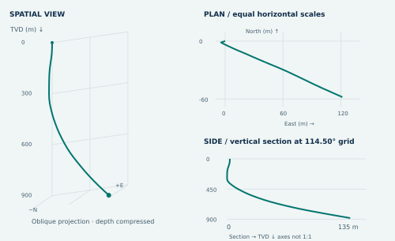
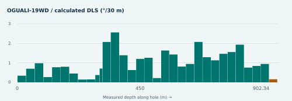
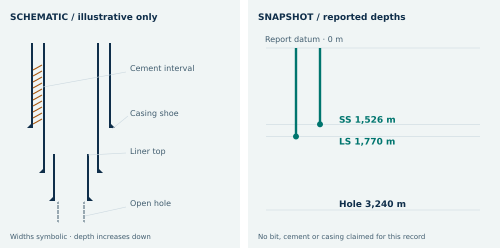

# Reading a well from its reports

*Design review   /   20 November 2026*

[View the original illustrated PDF](well-visuals-engineering-plan.pdf) · Page references below refer to that edition.

Proposed Well Path, wellbore diagram and bit / string depth views for WellSenseIQ. For approval before implementation; nothing here is a live operations display.

### One well, three different questions

| Question | View | What you can conclude |
| --- | --- | --- |
| Where was the hole drilled? | Surveyed trajectory | Direction and position at recorded stations. The connecting line is calculated, not a downhole measurement at every metre. |
| What has been installed? | Wellbore schematic | Casing shoes and documented string intervals along measured depth. Width helps identify equipment; it is not a clearance drawing. |
| Where was the tool or string? | Report snapshot | The reported position at a stated time or status. It can move up while the hole bottom stays put. |

### Recommended first release

Start with a survey attachment review in Daily Reports, two linked 2D projections, an interval DLS chart, a shoe-only schematic when that is all we know, and separate hole / bit / string markers. Add the source and “Explain this” action at the mark itself. Keep the existing pages, extraction and exports.

Add rotatable 3D as another view of exactly the same stations, not a prerequisite for reading the well. Add liners, cement, completion equipment and plan overlays only where the record describes them. Nothing should require a survey on a non-survey day.

### Review route

02 · Sample-file audit　 /　03 · Trajectory preview　 /　04 · DLS preview and worked example　 /　05 · Schematic and string preview　 /　06 · Capture contract　 /　07 · Import workflow　 /　08 · Calculation rules　 /　09 · Code impact　 /　10 · Guide and large datasets　 /　11 · Delivery gates

> **Reading note:** These previews use a survey workbook and a completion PDF for different wells. The two records are never joined. No sample was imported into a workspace. Synthetic equipment on page 5 is explicitly separated from the real report.

## What the files actually contain

*01   /   Evidence inventory*

Read the five legacy Excel workbooks in MODEL REPORTS/survey reports. Counts below include the MD-zero row. They are cumulative station lists, not 372 new measurements made on the report dates.

| Workbook identity¹ | Rows / last MD | Mapping decision |
| --- | --- | --- |
| ACHARA-8 | 46 / 1,315.20 m | Sheet1, rows 22–67. “North/South of Plan” and “East/West of Plan” are deviations, not actual coordinates. Use the tie-on and integrate actual MD/Inc/Azi. |
| AKUOYIBO-4 | 96 / 2,743.44 m | Rows 22–117. Course length, Northings/Eastings, planned Inc/Azi and closure. N/E start at zero; confirm local-offset basis, do not add grid coordinates twice. |
| SAKA CREEK-4PH | 100 / 1,898.79 m | Rows 23–122. Separate signed N/S, E/W and grid Y, X. Unit headings include misencoded degree signs. |
| ENYIE-SW-7ST | 97 / 2,731.85 m | Rows 21–117. Plan-relative offsets again; preserve ST branch and Excel serial date. Header row is not at the same index as ACHARA. |
| Oguali-19 (filename) | 33 / 902.34 m | Rows 23–55. Header says OGUALI-19WD; wellbore field blank. Require user match, never attach by filename alone. Both grid and relative positions. |

¹ Short identifiers for the supplied files; values read from workbook cells, not inferred from filenames. All five have actual MD, inclination, azimuth, TVD, VSEC and interval rates; headers include Grid north, section direction and elevation information. Preserve comments (e.g. gyro, MWD, tie-on), original precision and blanks.

### Two operation reports show why time and identity matter

**AKUOYIBO DDR #15, 16 Nov, p.1:** §1.3 closes at 1,968 m MD; §1.4 current status says drilling at 2,000 m. The Nov 20 survey reaches 2,743.44 m. Do not rewrite the Nov 16 closing depth with either later observation. A header also prints 16 in @ 67 m; that establishes a reported shoe, not an entire casing history.

**DCR #13, 16 Nov, p.1:** the filename says ACHARA SOUTH-4MH but §1.2 names ACHARA-SOUTH-4PH. Match well and bore explicitly. §1.4 distinguishes long and short completion strings; the summary and current status refer to different positions. See page 5.

## One trajectory, three ways to see it

*02   /   Output preview*

OGUALI-19WD · workbook dated 20 Nov 2026 · Grid north · KB elevation 55.50 m · 33 stations. This review sketch joins printed station positions; implementation will show calculated coordinates and printed comparisons.

**Read from the first station to the last dot.** Imagine lowering a tape along the hole: it reads 902.34 m (MD). A plumb line to that same level reads 881.85 m (TVD). Seen from above, the endpoint is 121.60 m east and 58.13 m south of the origin. Nothing in this file tells us where the bit is now.

**Plan view** means looking down, not “planned well”. **Vertical section** is the shadow of the path on a vertical plane facing the stated bearing; sideways motion out of that plane disappears. The endpoint projects to 134.75 m along this plane. Rotating the plane changes the shadow, not the well or its DLS.

> **Reading note:** Select a station in any view to highlight it in the other two and open its exact row. A single station is a point. With no survey, show no path. Beyond the last station show unsurveyed MD as a separate annotation, never as a continuation of the 3D line.

## Dogleg severity is an interval

*03   /   Output preview*

DLS answers “how much did the direction change per length drilled?” It is not inclination, not azimuth change alone, and not a measurement of instantaneous curvature between the stations.

Each rectangle spans the actual MD interval, not one calendar day. Its height is the average directional change scaled to 30 m. The narrow highlighted interval belongs to its deeper station. Peaks identify intervals to inspect, not proof of unsafe drilling. Show printed DLS as an optional separate marker, not a substitute when calculation is impossible.

### Worked example · workbook rows 54 → 55

At 873.47 m: inclination 23.59°, azimuth 113.98°. At 902.34 m: inclination 23.62°, azimuth 114.35°. Course length L = 902.34 − 873.47 = 28.87 m. Use the angle between the two 3D tangent directions, not the difference between the MDs or the sum of the two angle changes.

Convert inclinations I₁, I₂ and azimuth difference ΔA to radians. Compute h = sin²((I₂ − I₁)/2) + sin(I₁) sin(I₂) sin²(ΔA/2). Clamp h to [0,1] for rounding. Dogleg β = 2 asin(√h) radians. DLS = degrees(β) × 30 / L when L is in metres.

Here β = 0.15117°. Calculated DLS ≈ **0.157 °/30 m**; printed column K rounds to 0.157. The azimuth changed 0.37°, but the hole was not horizontal, so that does not mean a 0.37° dogleg.

> **Reading note:** First station or invalid pair: “— no interval”, not zero. A straight valid pair gives zero. A 359° → 1° crossing is not a 358° dogleg. A printed rate in °/100 ft is multiplied by 30/30.48, not by the ft-to-m length factor. These five sheets already use °/30 m.

## Construction versus moving strings

*04   /   Output preview*

Left: symbol key using illustrative equipment only. Right: actual values from DCR #13, page 1, dated 16 Nov 2026. These are separate drawings, not the same well inventory.

**Left:** two casing walls end at a shoe (wedge). A liner begins downhole inside the previous casing, not at surface. A tieback needs its own top and connection to the liner. Hatch only a known cement interval in its named annulus; do not imply a verified barrier from a planned cement job. Depth is MD, not the geographic shape of a deviated well.

**Right:** the report’s Depth Days header gives MD 3,240.00 m and TVD 2,426.03 m. Current status says “LS TO 1770 M & SS TO 1526 M.” Use status as the observation basis; the report has no station time for those numbers. No survey upload is needed to show these three depths. The lines track endpoints, not pipe tally lengths or an installation certificate.

**Bit depth in drilling:** use a distinctly labeled triangle at the confirmed bit MD. A separate horizontal rule marks closing hole MD. Off-bottom distance = hole MD − bit MD only when contemporaneous, same datum and same bore; otherwise show “not comparable”. Missing is not surface. “Out of hole” requires an explicit observation.

> **Reading note:** A recorded shoe with unknown top gets a wedge and label only. A configured hole section may appear dashed as design, never as installed casing. Below the last known shoe say “casing coverage unknown” unless open hole is supported; no fabricated tubing, PBTD, packer, cement or TD.

## Where each mark gets its data

*05   /   Data contract*

Required means required for that layer only. Keep core daily report submission possible without equipment, a survey or a position observation. Each mark needs scope, wellbore and an as-of basis.

| Mark / owner | Minimum capture and source | If not present |
| --- | --- | --- |
| Hole depth · daily | Daily report Depth tab / confirmed DDR or DCR: closing depth_end_m, unit, datum, cutoff; printed tvd_m separate. Label date and status. | No value; never use the newest survey as the closing report. |
| Bit or string · daily | Depth tab: typed observation, measured endpoint MD, unit, string ID (bit / workstring / tubing LS or SS / tool), time or “report status”, status text and evidence. Allow multiple per day. | Legacy bit_depth_m stays readable; if type or time unclear, show “reported operating depth — unclassified”. |
| Trajectory · survey | Sources & surveys: MD, Inc, Azi, well + branch/run, north reference, unit, tie-on MD/TVD/N/E and datum. Optional printed TVD/N/E, DLS, VSEC, comments, survey timestamp. | Table of available facts. Relative-only segment if no absolute anchor, no origin asserted. |
| Shoe / equipment · well | Last casing size and shoe MD from Depth or engineer-confirmed equipment record. Full string needs ID/type, OD, top and base MD, as-run date/status. Hole size ≠ pipe OD. | Shoe only; planned or unknown top not shown solid. Same OD can identify several different strings. |
| Completion layers · well | Optional liner hanger/top, tieback connection, tubing/packer setting MD, perforated interval, PBTD, or TOC/base + annulus + verification basis from DCR, tally or cement job. | No layer until entered. Distinguish planned, run, retrieved and superseded by date. |
| Time / plan · programme | Date/cutoff + closing MD and separate typed positions by report. Active plan version: cumulative days, target MD, agreed start date. Directional overlay needs a separate approved station series with compatible origin. | Show observed dots only; no faked time log or planned 3D curve from a time/depth schedule. |

**Lineage on select:** recorded / calculated / configured / missing, original value and unit, source document → page + section or workbook → sheet + row/column, report # + date/status, manual author or reviewer and revision. Calculated facts link both inputs and the calculation version. No invented station timestamps from the file date.

## Upload only when a survey exists

*06   /   Capture flow*

Proposed entry point: Well Operations → Daily Reports → open a draft → Sources & surveys → Attach survey workbook. Keep Add station and existing report extraction as alternatives.

### 1   Identify

Select the report, scope and wellbore. Read well, field, wellbore, sheet date, north reference, projection, map zone, geodetic datum, surface N/E, KB/GL and VSECT DIREC from the header. Show file identity beside the selected workspace identity. Require explicit resolution for blank/different wellbore names or a sidetrack.

### 2   Preview, no write

Detect actual binary .xls separately from OOXML .xlsx; use a bounded read-only parser, reject encrypted/oversized inputs with a useful error, never execute macros or external formulas. Extract cached cell values; flag unusable formulas. Normalize broken degree signs, multiline headers, blank/merged metadata cells, date serials and alternate names. Map by meaning + unit, not column index.

### 3   Classify the columns

Show actual angles, planned angles, local N/E, absolute grid X/Y, offsets from plan, TVD vs subsea TVD, printed rates and comments separately. Guess neither the column role nor datum if ambiguous: show sample cells for engineer confirmation. m/ft must be known. Offer sheet selection and source row ranges.

### 4   Review differences

Group by org, wellbore, run/tie-on and survey reference; compare to accepted station identities. A cumulative re-upload may contain 0 new rows. Show new / identical / conflicting / invalid counts and before→after values. Different run at same MD is not automatically a revision. Keep independent ties and conflicting gyro/MWD readings for review; block ambiguous geometry.

### 5   Apply deliberately

Reviewer selects rows and confirms. Atomically attach evidence, add new stations or link identical ones to the new source; supersede a conflict only with a reason. Preserve manual edits, original row, old revision and user. A second import is idempotent. Cancel writes no report/station changes. Respect role and report lock; existing reopen-to-draft rules remain.

### 6   Between survey days

No upload required; do not clone stations into each daily report. Show last accepted survey date, MD and confirmed branch, plus today’s observations. For completion, optionally reference the matching drilling trajectory read-only with its original scope/date. Unknown parent or no permission → no cross-scope curve. No future survey on a historical report.

> **Reading note:** Example preview: OGUALI-19WD · 33 candidate rows · filename differs from well header · wellbore blank → “Confirm destination” before Apply. If its 33 rows are already accepted, display “0 new · 33 matching”; do not create another 33 stations.

## How geometry becomes a chart

*07   /   Calculation contract*

Implement once on the backend; the dashboard, report preview, full page, exports and Guide consume the same resolved values. Keep raw report values alongside results, never overwrite them to force agreement.

### Minimum curvature → position at each station

For each adjacent valid pair in one continuous bore segment, use L and β from page 4. Direction vector u(I,A) = (sin I cos A, sin I sin A, cos I) in North, East, Down. Ratio factor RF = 2 tan(β/2) / β, or 1 as β → 0. Increment (ΔN, ΔE, ΔTVD) = L × RF × (u₁ + u₂) / 2. Add to the accepted tie-on position. Compute unrounded; round only for display. Bound invalid or near-opposed directions for review before integration.

World grid = confirmed surface grid coordinate + local offset, only in the same projected CRS. Departure = √(N²+E²); closure bearing = atan2(E,N) clockwise from grid north, undefined at zero departure. VSEC = N cos θ + E sin θ for a surface origin; subtract section-origin offsets if applicable. Prefer header θ, then explicit override; label closure-derived θ if chosen as fallback. Do not mix magnetic, true and grid bearings without documented conversion.

### Depth, angle and time tracks

TVD increases downward from its stated datum. A reported subsea depth with positive-down convention is TVD from KB minus KB elevation above MSL; confirm sign before conversion. A matching survey station has a calculated TVD; between valid bracketing stations label any linear MD→TVD estimate “interpolated”. No extrapolation across gaps or outside coverage; prefer an explicitly paired header MD/TVD when showing that report.

Plot Inc (0° vertical, 90° horizontal) and Azi (clockwise from reference north) as separate scales versus MD. Break at azimuth wrap instead of drawing a false full turn. A first Inc ≥1° is a threshold crossing, not necessarily the planned kick-off. Printed build ≈ ΔInc × 30/L; these sheets’ turn is commonly wrapped ΔAzi × 30/L. Existing computed turn is inclination-weighted: label separately, never compare as the same quantity.

Time–depth: x = report date or elapsed days from a stated origin, y = MD increasing down. Show actual observations, active schedule dashed, bit/string symbols distinct. No progress or ROP inferred from bit movement; completion ROP N/A. Any drilling distance/time KPI must identify interval, footage source and drilling hours denominator; missing/zero time → N/A.

### Evidence and quality rules

Require finite values, increasing MD, valid angle ranges and compatible datum/branch. Exact vertical has no meaningful azimuth; otherwise do not insert north for missing Azi. Flag repeated MD, long spacing or discontinuity; do not bridge an unresolved interval. Large spacing gives a coarse average, not curvature detail. Keep printed vs calculated TVD (existing >1 m flag), VSEC, N/E and DLS differences visible with unit/rounding context. A warning is not permission to silently correct a report.

## What to reuse and where to intervene

*08   /   Engineering impact*

Static inspection of the current branch. These are proposed additive changes, not a migration performed during this review.

| Existing location | Finding → proposed adjustment |
| --- | --- |
| backend/app/domain/operations/trajectory.py | Already implements stable zero-dogleg minimum curvature, summary and section projection. First station gets DLS=0; missing first position may use MD×cos Inc and zero offsets. Add explicit anchor/interval validity and nullable display facts; do not draw an assumed surface tie. |
| backend/app/services/operations/well_path.py | Collects current surveys by org/well/scope. Missing Azi becomes 0 even after warning; duplicate MD is last row in MD/station order, not necessarily latest report. Add explicit branch, revision and as-of resolver. Verified depth preferred over draft; show the actual chosen date. Separate survey endpoint, report MD and snapshot depth rather than max(report MD, survey MD). |
| WellDiagram.tsx / WellPath.tsx / WellPathPanel.tsx | Existing SVG, ECharts plan/steering, table, compact cards and chart export are useful. Depth caption and MD/TVD axes can disagree; diagram extrapolates beyond surveys. Plan tooltip swaps N/E labels relative to plotted data. Split MD construction from TVD section; correct empty states, N/E labels, first-interval and last-station wording. |
| ReportDetail.tsx / openwells.py / workbooks.py | Keep manual entry and searchable DDR/DCR prefills. Narrative extraction currently groups operating bit/string depth. Add typed, reviewed observations and a separate survey-workbook preview/apply path. Existing openpyxl path does not decode these legacy .xls files simply because a filename ends in .xls. |
| models/operations.py / schemas/operations.py / api/operations.py | Extend OpsSurvey/source links (report, source_page, current flag already exist). Add normalized survey-set/tie-on, evidence/revision, equipment interval and depth-observation records; nullable columns/foreign keys, not JSON. Preserve old fields/read responses; new optional details on demand. |
| operations/guide.py / study_knowledge.py / assistant.py | Extend the existing operations engineering knowledge and both Guide entry points, not another chatbot. Route well-specific questions through the same authorized snapshot/interval service; general explanations deterministic even with Ollama off. |

**External reference:** ArokyaMatthew/DrillMind @ bcc9e5d, dashboard/index.html, dashboard/app.js and README. Borrow adjacent time–depth, schematic and source-aware detail. Its SVG hard-codes Volve casing/seabed; its rig-state and alerts use streamed sensor readings. Do not transplant dimensions, data feeds, thresholds or states.

## Explain, scroll, inspect, export

*09   /   Daily use*

The readable version should work without rotating a 3D plot, hovering a mouse or remembering an engineering formula.

### Proposed “Ask the guide” answers

**“Why does the survey stop before the hole bottom?”** “The line ends at the last accepted survey station. The hole depth is the selected report’s closing MD. No direction was measured in the remaining interval.” Include both sources, dates, scope/branch and MD gap only if comparable.

**“Show how DLS was calculated here.”** From an interval, pass the two station IDs, not chart pixels. Return the pair, MD/Inc/Azi inputs, ΔMD, β, normalization, computed and printed values, discrepancy and workbook rows (page 4 example). For one station: “I need a previous valid station.” Link back to the selected interval.

**“Why is my short string above hole bottom?”** “DCR #13 reports the short string at 1,526 m in Current status and the hole at 3,240 m in Depth Days. One is equipment position; the other is the drilled hole. They need not match.” Do not assert a bit was on bottom or infer status time.

**“What does this symbol mean?”** Open the legend entry for shoe, liner, cement, tieback, packer, PBTD or bit; show definition, required field, recorded vs design status and source. A missing layer should offer the correct entry tab, not an invented value. Use this same pattern for each projection, angle, date plot and KPI.

### Large-data interaction

Default to Fit well. Offer MD from/to, jump to station/shoe or current tool, zoom +/−, reset and full-screen; a bounded vertical scrolling MD track with pinned ruler and overview window. Sync MD selection across projections, tracks and table, not raw pixel scroll (TVD ≠ MD). 3D rotate/pan/reset, named axes and a 1:1 mode or clear exaggeration. Use equal E/N scale; handle negative offsets and horizontal/returning sections.

Retain the searchable station grid, sticky headings, horizontal scroll for optional columns, and 20/50/100 pagination. Use lazy/paged detail for long surveys; decimate only display geometry, retaining endpoints, selected points and interval extrema. Stats and exported rows use full resolution. On narrow screens stack charts; keyboard selection opens the same source drawer as a tap. Use shapes, labels and patterns as well as theme colours.

Preserve role-filtered XLSX/CSV and PDF paths. In PDF fit the whole well or explicitly label selected depth window; include units, source, datum, date, legend and static 2D fallback to 3D. Never export only the clipped scroll viewport by accident.

## Implementation gates

*10   /   Decision and sequencing*

Recommendation: approve the evidence and 2D workflow first. Nothing in the first release should depend on telemetry, a new daily upload, a GPU, or a complete as-built equipment list.

| Order | Deliverable and review gate |
| --- | --- |
| 1 · Inputs and identity | Agree branch naming, date/cutoff semantics, datum, unit and survey revision policy. Approve source badges, empty states and distinction between actual and planned. Baseline existing report, dashboard, summary, Guide and export behavior. |
| 2 · Capture | Add nullable, indexed, tenant-scoped records with audited writes. Preserve backward reads; no destructive backfill. Draft-only workbook preview/manual entry under existing capabilities, Save / Discard / Continue editing. Gate: five mapped samples; second upload adds no stations; wrong branch cannot apply. |
| 3 · Calculations and 2D | One as-of resolver + pair calculator for all surfaces. Ship plan/section, Inc/Azi, DLS intervals, discrepancies, station table and source drill-through. Gate: reproduce Oguali worked example at printed precision; no future station, false north, fabricated zero or extrapolated path. |
| 4 · Construction and positions | Report snapshot lanes, shoe-only fallback, optional as-run equipment and inferred-vs-confirmed flags. Gate: DDR #15 is not relabeled 2,000 m at close; DCR #13 shows both strings, no fake bit and no new drilling survey. |
| 5 · Education and scale | Ship Guide memory/routing, standalone illustrated help, in-chart Explain this, zoom/scroll and accessible exports. Review missing/draft/reopened reports, permission-denied sources, dark/light, mobile, large cumulative survey and historical PDF. |
| 6 · Optional enhancements | Lazy-load 3D with 2D fallback; allow a separately approved directional plan, date-based performance panels or offset overlay only with compatible reference frames and permissions. Feature-gate layers; preserve old view until reviewed. Roll back UI/read path without losing accepted observations. |

### Which reference dashboards fit?

**Now:** recorded trajectory, casing shoes, point-in-time depth, report-based time/depth. **Conditional:** activity-duration sums from confirmed non-overlapping time blocks; drilling-hours ROP from matched footage/time; rotary/slide split only with explicit mode and footage. Keep existing analytics and label coverage. **Defer:** continuous torque/RPM logs, toolface dial, live duty cycle, vibration, anti-collision clearance and predictive alarms. Daily snapshots cannot substantiate these.

### Decisions requested before build

Approve the snapshot-first layout and Grid/KB/source labels? Accept optional uploads on survey days only, with branch confirmation and a reviewed, read-only drilling path in completion? Keep separate long/short/tool observations and allow unknown equipment tops? If available later, supply an as-run casing/tubing tally or cement interval record and a versioned directional plan; neither is needed to start the survey view.
